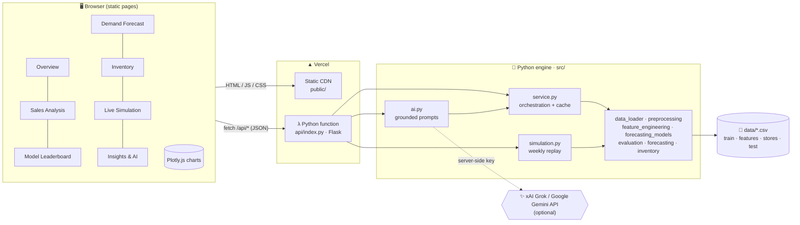
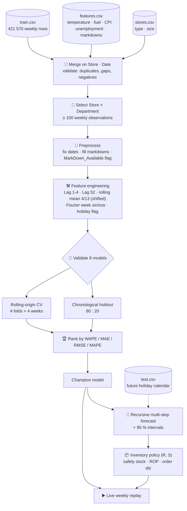
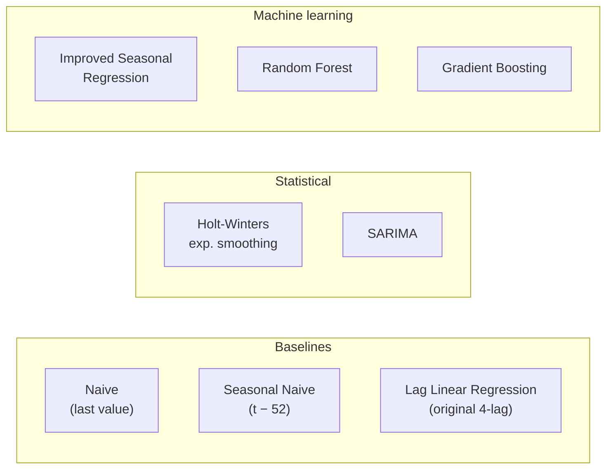
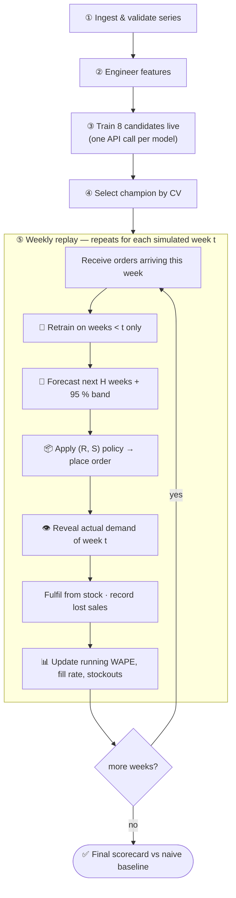
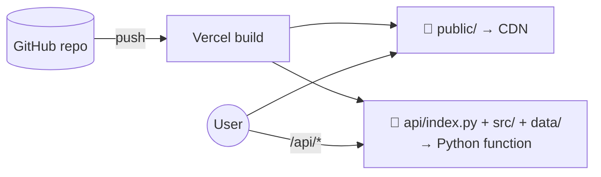

<div align="center">

# 🛒 Retail Demand Forecasting & Inventory Decision Support

**Forecast weekly demand, validate eight models, and turn the forecast into a replenishment plan — with a live week-by-week simulation, all running on a real Python engine behind a deployable web app.**

[](https://www.python.org/)
[](https://flask.palletsprojects.com/)
[](https://scikit-learn.org/)
[](https://www.statsmodels.org/)
[](https://pandas.pydata.org/)
[](https://numpy.org/)
[](https://plotly.com/javascript/)
[](https://vercel.com/)
[](https://aistudio.google.com/)
[](#-testing)

[**Features**](#-features) ·
[**Quick start**](#-quick-start) ·
[**Architecture**](#-architecture) ·
[**Pages**](#-pages) ·
[**Models**](#-the-eight-models) ·
[**API**](#-api-reference) ·
[**Deploy**](#-deploy-to-vercel) ·
[**AI analyst**](#-ai-analyst-xai-grok-or-google-gemini) ·
[**Structure**](#-project-structure)

</div>

---

## 📑 Table of contents

1. [Features](#-features)
2. [Quick start](#-quick-start)
3. [Architecture](#-architecture)
4. [Data & modelling pipeline](#-data--modelling-pipeline)
5. [Pages](#-pages)
6. [The eight models](#-the-eight-models)
7. [Validation methodology](#-validation-methodology)
8. [Inventory policy](#-inventory-policy)
9. [Live simulation](#-live-simulation)
10. [API reference](#-api-reference)
11. [Deploy to Vercel](#-deploy-to-vercel)
12. [AI analyst (xAI Grok or Google Gemini)](#-ai-analyst-xai-grok-or-google-gemini)
13. [Testing](#-testing)
14. [Project structure](#-project-structure)
15. [Technology stack](#-technology-stack)
16. [Notes & limitations](#-notes--limitations)

---

## ✨ Features

| | |
|---|---|
| 📈 **Eight forecasting models** | Naive, seasonal naive, Holt-Winters, SARIMA, lag regression, improved seasonal regression, Random Forest, Gradient Boosting — compared head to head. |
| 🧪 **Honest validation** | Four-fold rolling-origin cross-validation (primary) plus a chronological 80:20 holdout (secondary). No shuffling, no look-ahead. |
| 🎯 **Multi-step forecasts** | Recursive forecasting up to 26 weeks with 95 % prediction intervals calibrated on the model's own validation error. |
| 📅 **Real future calendar** | Future holiday flags, temperature, fuel price, CPI, unemployment and markdowns come from the dataset's own calendar when available. |
| 📦 **Inventory planning** | Safety stock, reorder point, order-up-to level and order size for a periodic-review (R, S) policy — in dollars or units. |
| ▶️ **Live weekly simulation** | Replays history week by week: **retrain → forecast → order → reveal demand → score**, against a naive baseline. |
| 🔍 **Sales analysis** | Seasonality profile, holiday surges, promotional markdowns, external-driver correlations. |
| 🤖 **Optional AI analyst** | Plug in an xAI Grok or Google AI Studio key for grounded executive briefings and Q&A. Works without a key too. |
| 🌗 **Polished UI** | Seven pages, light/dark themes, responsive down to phone width, no build step. |

---

## 🚀 Quick start

```bash
# 1. clone and enter the project
git clone <your-repo-url> retail-demand-forecasting
cd retail-demand-forecasting

# 2. create an environment and install
python -m venv .venv && source .venv/bin/activate      # Windows: .venv\Scripts\activate
pip install -r requirements.txt

# 3. run the full app (static pages + API) on http://127.0.0.1:3000
python scripts/dev_server.py
```

Optional: `cp .env.example .env` and add `GEMINI_API_KEY` to enable the AI analyst. For tests and notebooks use `pip install -r requirements-dev.txt`.

---

## 🏗 Architecture



The browser holds **no model logic**: every number on every page is computed by the Python engine on demand and cached per warm instance.

---

## 🔬 Data & modelling pipeline



**Leakage control.** Lags and rolling statistics are shifted so that week *t* never sees its own sales; the first 52 weeks are consumed as warm-up for `Lag_52`; recursive forecasts feed predictions — never actuals — back in as lags.

---

## 🧭 Pages

| Page | URL | What you get |
|---|---|---|
| **Overview** | `/` | KPIs, trend with 4-week average and holiday markers, optional linear trend, champion summary, data-integrity diagnostics |
| **Sales Analysis** | `/eda` | Annual seasonal profile (±1σ band), peak/low weeks, holiday box-plots and event uplift, markdown history, promo comparison, driver correlations |
| **Model Leaderboard** | `/models` | CV and holdout rankings, actual-vs-predicted, residual diagnostics, holiday-shock table, baseline-vs-improved, model catalog |
| **Demand Forecast** | `/forecast` | Choose model and horizon (1–26 weeks), forecast fan chart, table with CSV download, feature-driver chart |
| **Inventory Planning** | `/inventory` | Interactive (R, S) policy in $ or units, position-vs-levels chart, service-level and lead-time sensitivity |
| **Live Simulation** | `/simulation` | Five-stage live pipeline then a weekly replay with retraining, fan chart, running WAPE, inventory trace and event log |
| **Insights & AI** | `/insights` | Evidence-based takeaways, limitations, rule-based or Gemini-powered briefing and Q&A |

Every page shares a **Store / Department / Rank-by** selector (kept in the URL, so views are shareable).

---

## 🤖 The eight models



Example leaderboard — Store 1, Department 1 (rolling-origin CV, WAPE, lower is better):

| # | Model | WAPE | MAE |
|:-:|---|---:|---:|
| 🥇 | **Improved Seasonal Regression** | **4.22 %** | $810 |
| 2 | Random Forest | 5.23 % | $1,030 |
| 3 | Gradient Boosting | 6.38 % | $1,316 |
| 4 | Seasonal Naive (t−52) | 6.80 % | $1,281 |
| 5 | SARIMA | 11.28 % | $2,338 |
| 6 | Naive (last value) | 11.31 % | $2,343 |
| 7 | Holt-Winters | 11.59 % | $2,435 |
| 8 | Lag Linear Regression (baseline) | 15.64 % | $2,767 |

Adding annual seasonality cut the original baseline's error by **73 %**. Rankings differ by series — that is why the app validates per Store × Department instead of hard-coding a winner.

---

## 🧪 Validation methodology

| Metric | Meaning |
|---|---|
| **WAPE** | Σ\|error\| ÷ Σactual — robust to zero/low weeks; the default ranking metric |
| **MAE** | Average absolute dollar error |
| **RMSE** | Penalises large misses |
| **MAPE** | Mean % error (zero-actuals excluded) |

- **Rolling-origin CV (primary)** — expanding window, 4 folds, each forecasting the next 4 weeks. Reveals whether a model is consistently good across seasons.
- **Chronological holdout (secondary)** — last 20 % of weeks. Volatile for short series, so used as a cross-check only.
- **Holiday-shock table** — compares holiday vs non-holiday error, with a warning when the holiday sample is tiny.

---

## 📦 Inventory policy

Periodic-review **(R, S)** policy on forecast demand:

```
SS  = Z · σ · √(L + R)               safety stock
ROP = d · L + SS                      reorder point
S   = d · (L + R) + SS                order-up-to level
Q   = max(0, S − (on-hand + on-order − backorders))
```

`d` weekly demand · `σ` weekly demand std · `L` lead time · `R` review period · `Z` normal quantile of the service level.

> `Weekly_Sales` is **monetary revenue**, not units. Buffers are therefore in dollars by default; a unit mode converts through a declared average selling price.

---

## ▶️ Live simulation



The server is **stateless**: inventory and accuracy state is returned with each step and sent back with the next, so any serverless instance can serve any step.

---

## 🔌 API reference

All endpoints are JSON; query parameters `store`, `dept` (default 1) and `metric` (`wape` · `rmse` · `mae` · `mape`).

| Method | Endpoint | Purpose |
|---|---|---|
| GET | `/api/health` | Liveness + AI status |
| GET | `/api/meta` | Stores, departments, models, dataset summary |
| GET | `/api/series` | Weekly series, KPIs, trend, diagnostics |
| GET | `/api/eda` | Seasonality, holiday, promotion, driver analysis |
| GET | `/api/evaluate` | Full 8-model leaderboard, residuals, shocks |
| GET | `/api/evaluate/model?model=<key>` | One model (used by the live pipeline) |
| GET | `/api/forecast?model=auto&horizon=8` | Multi-step forecast with intervals and drivers |
| POST | `/api/inventory` | Inventory policy + sensitivities |
| GET | `/api/simulate/bounds` | Valid replay window |
| POST | `/api/simulate/step` | One retrain-forecast-replenish step |
| GET | `/api/ai/status` | Whether an AI key is configured |
| POST | `/api/ai/briefing` | Rule-based notes (+ AI briefing if keyed) |
| POST | `/api/ai/ask` | Free-form grounded question (needs key) |

---

## ▲ Deploy to Vercel

1. **Push** this folder to a GitHub repository (replace the old contents).
2. In Vercel choose **Add New → Project**, import the repository and keep the defaults — `vercel.json` already sets the output directory, clean URLs, the API rewrite and a 60-second function limit.
3. *(Optional)* add environment variables under **Settings → Environment Variables** (see [AI analyst](#-ai-analyst-xai-grok-or-google-gemini)).
4. **Deploy.** Static pages are served from the CDN; `/api/*` runs the Python function.



Cold start loads the 421 k-row dataset (~1 s); warm requests are cached in memory. Dependencies (~330 MB unpacked) fit within Vercel's Python function limit; the dataset is read from the bundled `data/` folder.

---

## ✨ AI analyst (xAI Grok or Google Gemini)

The app works fully without AI. To enable generative briefings and Q&A, add **one** API key as a server environment variable (Vercel → Settings → Environment Variables, or a local `.env`) and **redeploy**:

| Variable | Required | Purpose |
|---|:-:|---|
| `XAI_API_KEY` (or `GROK_API_KEY`) | one key needed | xAI Grok key (starts with `xai-`) |
| `GEMINI_API_KEY` (or `GOOGLE_API_KEY`) | one key needed | Google AI Studio key (starts with `AIza`) |
| `AI_PROVIDER` | ❌ | Force `xai` or `gemini` (otherwise detected from the key) |
| `AI_MODEL` | ❌ | Model id. If unset, the app asks the provider which models your key can use and picks a fast one |
| `AI_RATE_LIMIT` | ❌ | Requests per client per 10 minutes (default `30`) |

Design notes: the key stays **server-side** (never sent to the browser); prompts are **grounded** on numbers produced by the engine; user questions are length-limited and treated as plain text. The code lives in [`src/ai.py`](src/ai.py).

---

## ✅ Testing

```bash
pip install -r requirements-dev.txt
python -m pytest -q          # 32 tests: engine, leakage checks, API, simulation, AI fallback
```

Covers data loading and joins, non-leaking features, metric edge cases, chronological splits, all eight models, recursive forecasting, inventory maths, API contracts, stateless simulation steps and the mocked Grok and Gemini calls.

---

## 🗂 Project structure

```text
retail-demand-forecasting/
├── api/
│   └── index.py                 # Flask app — Vercel serverless entrypoint
├── public/                      # static front-end (no build step)
│   ├── index.html  eda.html  models.html  forecast.html
│   ├── inventory.html  simulation.html  insights.html
│   └── assets/
│       ├── css/style.css        # design system, light/dark
│       ├── js/core.js           # shell, API client, theme, chart helpers
│       ├── js/pages/*.js        # one module per page
│       └── vendor/              # Plotly.js (bundled, MIT)
├── src/                         # Python engine
│   ├── data_loader.py           # load, merge, validate, select series
│   ├── preprocessing.py         # cleaning, markdown handling
│   ├── feature_engineering.py   # lags, rolling stats, seasonality
│   ├── forecasting_models.py    # the eight models
│   ├── evaluation.py            # metrics, holdout, rolling-origin CV
│   ├── forecasting.py           # recursive multi-step forecast
│   ├── inventory.py             # (R, S) policy maths
│   ├── service.py               # JSON service layer + caching
│   ├── simulation.py            # live weekly replay
│   ├── ai.py                    # optional Grok / Gemini integration
│   └── visualization.py         # Matplotlib/Plotly helpers for notebooks
├── data/                        # train · features · stores · test (CSV)
├── notebooks/                   # analysis notebooks
├── tests/                       # pytest suite
├── scripts/                     # dev server, notebook tooling
├── vercel.json  requirements.txt  .env.example  .python-version
└── README.md
```

---

## 🧰 Technology stack

| Layer | Tools |
|---|---|
| Language |  -F7DF1E?logo=javascript&logoColor=black)   |
| Data & numerics |   |
| Forecasting |   |
| API |  |
| Visualisation |  -11557C) |
| AI (optional) |  |
| Hosting & CI |    |

---

## ⚠️ Notes & limitations

- **Monetary, not units.** Sales are weekly revenue; price changes and inflation blur demand.
- **Short history** (≈ 2.7 years) limits how well annual cycles can be learned; Lag-52 needs a full prior year.
- **Known covariates.** Weather, CPI and fuel for future weeks are taken from the dataset calendar, which assumes good forecasts of those drivers.
- **Markdown regime change.** Promotions are only recorded from November 2011; earlier weeks are *unrecorded*, not zero.
- **Simulation assumptions.** Lost sales (no backorders), a fixed lead time, and a start fully stocked at the order-up-to level.
- **Eligibility.** Series with fewer than 100 weekly observations are excluded from modelling.
- Holiday accuracy on a short test window rests on very few weeks — treat it as indicative, not conclusive.
